# 03 — ERD (Entity Relationship Diagram)

```mermaid
erDiagram
    organization ||--o{ branches : has
    branches ||--o{ users : "contains staff"
    branches ||--o{ warehouses : has
    branches ||--o{ cashier_shifts : has
    branches ||--o{ invoices : owns
    branches ||--o{ visits : owns
    branches ||--o{ appointments : owns

    users ||--o{ user_role_assignments : has
    roles ||--o{ user_role_assignments : assigned_to
    user_role_assignments }o--|| branches : scoped_to
    roles ||--o{ role_permissions : has
    permissions ||--o{ role_permissions : granted_in
    users ||--o{ user_permission_overrides : has
    users ||--o{ sessions : has
    users ||--o{ staff_profiles : has

    customers ||--o{ customer_accounts : has
    customers ||--o{ pet_owners : owns
    pets ||--o{ pet_owners : owned_by
    pets ||--o{ visits : has
    pets ||--o{ boarding_reservations : has
    pets ||--o{ grooming_jobs : has
    pets ||--o{ pet_weights : tracked
    pets ||--o{ consents : has

    visits ||--o{ queue_tickets : generates
    visits ||--o{ medical_records : has
    visits ||--o{ invoices : generates
    medical_records ||--o{ medical_record_versions : versioned
    medical_records ||--o{ prescriptions : has
    medical_records ||--o{ lab_orders : has
    medical_records ||--o{ vaccinations : has
    prescriptions ||--o{ prescription_items : contains
    prescriptions ||--o{ stock_movements : "deducts stock"
    vaccinations ||--o{ vaccine_protocols : follows

    products ||--o{ product_variants : has
    products ||--o{ product_barcodes : has
    products ||--o{ branch_prices : priced_at
    products ||--o{ bundles : part_of
    categories ||--o{ products : contains
    brands ||--o{ products : branded
    units ||--o{ unit_conversions : converts
    warehouses ||--o{ stock_batches : stores
    stock_batches ||--o{ stock_movements : moved
    stock_movements ||--o{ stock_balances : updates
    suppliers ||--o{ purchase_orders : supplies
    purchase_orders ||--o{ goods_receipts : received_by
    goods_receipts ||--o{ stock_batches : creates

    invoices ||--o{ invoice_items : contains
    invoices ||--o{ payments : paid_by
    invoices ||--o{ refunds : refunded_by
    payments ||--o{ payment_attempts : attempt
    invoice_items ||--o{ services : references
    invoice_items ||--o{ products : references

    appointments ||--o{ resources : uses
    rooms_cages ||--o{ boarding_reservations : assigned
    grooming_jobs ||--o{ resources : assigned_by_groomer

    commission_rules ||--o{ commission_entries : generates
    invoices ||--o{ commission_entries : basis_of
    expenses ||--o{ journal_entries : posts
    journal_entries ||--o{ accounts : posted_to
```

## Kamus Data (Inti)
- `organization` — satu owner per instalasi.
- `branches` — cabang operasional (petshop + klinik).
- `users` — staf (dua realm: staff/customer).
- `roles`, `permissions`, `role_permissions`, `user_role_assignments`, `user_permission_overrides` — RBAC.
- `customers`, `customer_accounts`, `pets`, `pet_owners`, `pet_weights`, `consents` — CRM.
- `products`, `product_variants`, `product_barcodes`, `categories`, `brands`, `units`, `unit_conversions`, `price_lists`, `branch_prices` — katalog.
- `warehouses`, `stock_batches`, `stock_movements`, `stock_balances` — ledger stok.
- `suppliers`, `purchase_orders`, `goods_receipts`, `stock_transfers`, `stock_opnames` — pengadaan.
- `services`, `service_packages`, `resources`, `rooms_cages` — layanan & resource.
- `cashier_shifts`, `cash_movements`, `invoices`, `invoice_items`, `payments`, `payment_attempts`, `refunds`, `vouchers`, `loyalty_ledgers`, `receivables`, `payables` — transaksi & keuangan.
- `visits`, `queue_tickets`, `medical_records`, `medical_record_versions`, `diagnoses`, `procedures`, `prescriptions`, `prescription_items`, `lab_orders`, `lab_results`, `vaccinations`, `vaccine_protocols`, `admissions`, `observations`, `medication_schedules`, `surgeries`, `consent_forms`, `form_templates`, `form_template_versions` — klinik.
- `appointments`, `availability_rules`, `time_off`, `grooming_jobs`, `boarding_reservations`, `boarding_daily_logs`, `work_schedules`, `attendance` — operasional & penjadwalan.
- `accounts`, `journal_entries`, `expenses`, `commission_rules`, `commission_entries`, `period_closings` — keuangan & komisi.
- `integration_connections`, `integration_routes`, `webhook_events`, `message_templates`, `notification_rules`, `outbound_messages`, `notification_inbox` — integrasi & notifikasi.
- `settings`, `feature_flags`, `document_sequences`, `files`, `audit_logs` — inti sistem.

Aturan: UUID v7 primary key, `created_at/updated_at/deleted_at`, `branch_id` di tabel ber-cabang, indeks untuk jalur kueri utama, constraint integritas (FK, check).